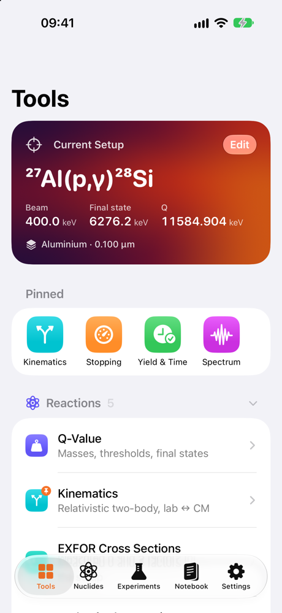
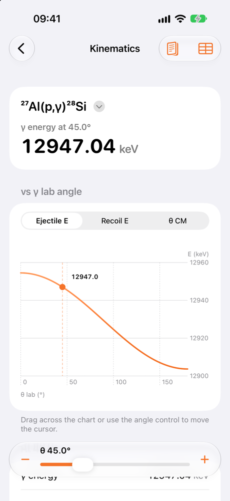
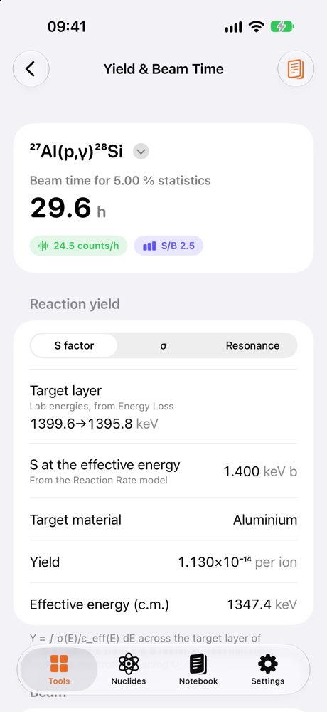
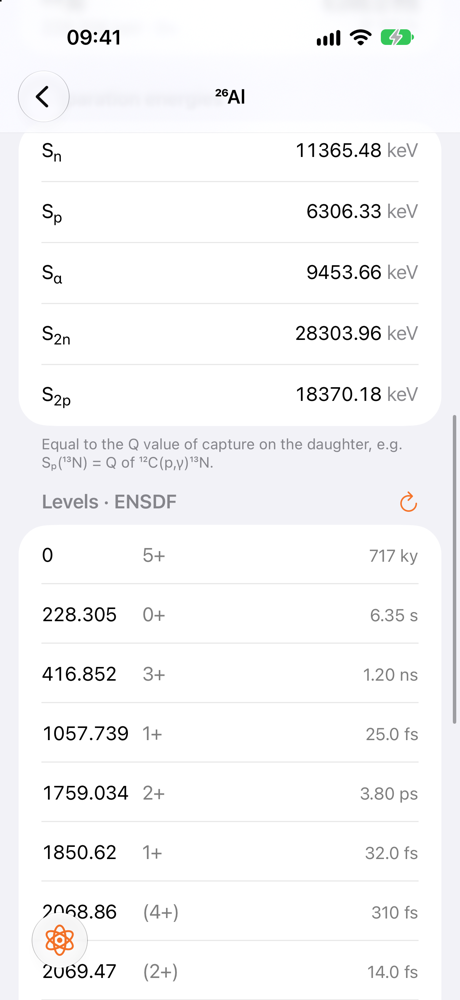
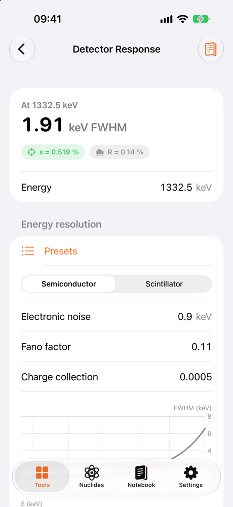
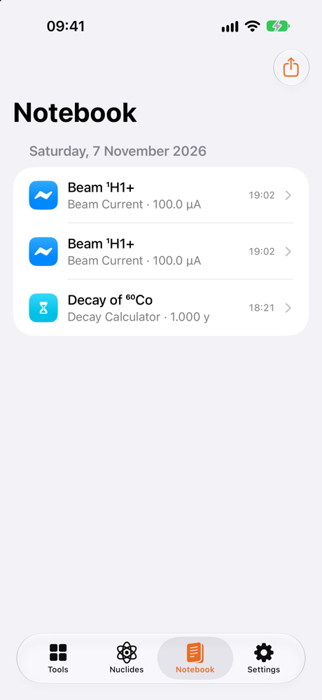

# Gamow — a pocket toolkit for experimental nuclear astrophysics


Gamow is a native iPhone and iPad app for the numbers an experimental nuclear physicist needs at the
accelerator, in the counting room or in a meeting: Q values and kinematics, SRIM stopping powers through target
stacks, Gamow windows, S factors and reaction rates, beam-time estimates, detector response, calibration sources
and nuclear data, including measured cross sections from EXFOR. It works offline, keeps a notebook of saved
calculations, and has no account, tracking or ads.

<p align="center">
  
  
  
  
</p>

## Features

One reaction setup (for example `27Al(p,g)28Si` at 1400 keV) is shared by all tools, so changing the beam energy or
the target updates every screen.

| Area | Tools |
|---|---|
| **Reactions** | Q value with AME2020 uncertainty, threshold, Q to excited states · relativistic two-body kinematics (both branches, lab ↔ c.m., recoil, Jacobian, CSV table) · Rutherford cross section and monitor counts · γ Doppler shift and broadening over the detector opening angle |
| **Stopping & targets** | SRIM-2013 stopping powers (Swift port of LunaSRIM), ranges and straggling · any composition from a formula (`Ta2N5`, `Ca(OH)2`, `TiD2`, `Ta2[17O]5`) or the SRIM compound library, gases from pressure and temperature · layer stacks with energy loss, straggling and mean energy in the target |
| **Nuclear astrophysics** | Gamow peak and window vs T₉ · S factor ↔ σ with electron screening · resonance strength ↔ thick-target yield · Nₐ⟨σv⟩ from a polynomial or tabulated S(E) plus narrow resonances (CSV import/export) · Coulomb penetrability, shift factor, Wigner limit, θ² |
| **Run planning** | Yield, count rate and beam time for a target statistical uncertainty, with background and the Currie detection limit · beam current ↔ particles/s, charge state, power on target, integrated charge |
| **Detectors & sources** | HPGe/scintillator resolution model · weighted efficiency-curve fit to your calibration points · calibration sources: activity today with uncertainty, γ lines with expected counts, air-kerma rate · decay calculator (activity, atoms, mass, time to a fraction) |
| **Reference** | CODATA 2018 constants · unit converter (energy, T₉ ↔ kT, barns, lengths, areal density, activity, time, charge) · formula sheet |
| **Nuclides** | AME2020 masses and separation energies · NUBASE2020 half-lives, Jπ, decay modes, abundances, isomers · ENSDF levels and γ rays from the IAEA LiveChart, cached for offline use |
| **Cross sections (EXFOR)** | Measured σ and S factors for p, d, t, ³He, α and heavy-ion reactions (51 871 tables) · every reaction on a nuclide, or the data for the current setup · overlay of all measurements with error bars, σ ↔ S and lab ↔ c.m. conversion, final-state selection · reference, facility and link to the EXFOR entry · CSV export · a measured S(E) can feed the rate tool |
| **Notebook** | Save any tool's inputs and results with a note; search; export as CSV, PDF or text |
| **System** | Shortcuts / Siri actions (Q value, Gamow peak, source activity, half-life) · Home and Lock Screen widget for a source's activity today |

<p align="center">
  
  
</p>

## Experiments and interactive plots

The **Experiments** tab stores named shared setups and run notes with measured charge and elapsed
time, restores setups for another calculation, and exports run records as JSON. Spectrum plots support
zoom/pan, energy cursors, ROI component counts and expanded views; kinematics and stopping plots have
expanded/focused views too. Calculator search is available on Tools.

The [calculation audit](docs/calculation-audit-2026-11-11.md) documents corrected target/yield behavior,
independent checks and validation limits.

## Custom experiment builder

Use **Tools → Build your experiment** to construct an arbitrary two-body reaction, edit compound
materials and beam layers, or open the gamma-spectrum tool. Add custom reaction/contaminant lines,
choose HPGe/BGO/NaI resolution, and insert compound foils in front of the detector. The spectrum
combines Gaussian photopeaks and a simplified Compton continuum with NIST foil attenuation;
line counts and continuum/peak ratio are experimental inputs. Export the expected spectrum as CSV.
See [the experiment-builder guide](docs/experiment-builder.md) for workflow, assumptions and validation.

## Install on your iPhone

You need a Mac with Xcode 26 and, for a free install, just an Apple ID.

```bash
git clone https://github.com/Alecompa/exp-nuc-phys-toolkit.git
```

```bash
open exp-nuc-phys-toolkit/Gamow.xcodeproj
```

1. Xcode ▸ Settings ▸ Accounts: add your Apple ID.
2. Select the **Gamow** and **GamowWidgets** targets ▸ Signing & Capabilities ▸ choose your team. If the bundle
   identifier is taken, change the prefix (`com.yourname.gamow`, `com.yourname.gamow.widgets`).
3. Connect the iPhone, enable Developer Mode on it, pick it as the run destination and press ⌘R.

With a free account the app has to be reinstalled every 7 days. [docs/release.md](docs/release.md) covers
TestFlight and the App Store.

## Project layout

| Path | Contents |
|---|---|
| `Packages/NucToolkit/Sources/NucPhysKit` | Physics only, no UI: masses, reactions, kinematics, `Stopping/` (SRIM-2013), `Astro/` (Coulomb functions, Gamow window, rates), `NuclearData/` (NUBASE, decay, LiveChart client, EXFOR index, table parser and client), `RunPlanning/` (beam, statistics, detectors) |
| `Packages/NucToolkit/Sources/ToolkitUI` | All SwiftUI screens |
| `Packages/NucToolkit/Tests/NucPhysKitTests` | Swift Testing suite: Q values against AME2020, kinematics conservation, 24 SRIM SR-module reference cases, Coulomb functions against mpmath, Gamow peak, rate formulae, NUBASE, decay, efficiency fit, EXFOR index and tables |
| `App/` | `@main` app target and the App Intents (Shortcuts) |
| `Widgets/` | Widget extension |
| `Data/` | Source tables: AME2020, NUBASE2020, SRIM-2013 data, raw IAEA LiveChart decay data |
| `Tools/` | Converters that build the bundled data, icon generator, test scripts |
| `project.yml` | [XcodeGen](https://github.com/yonaskolb/XcodeGen) spec; run `xcodegen generate` after editing it |

## Development

Run the physics tests on the Mac (needs Xcode, not only the Command Line Tools):

```bash
./Tools/test.sh
```

Regenerate the Xcode project after changing `project.yml`:

```bash
xcodegen generate
```

The bundled data are built from `Data/` by the scripts in `Tools/`, for example:

```bash
python3 -I Tools/convert_ame2020.py Data/mass_1.mas20.txt Packages/NucToolkit/Sources/NucPhysKit/Resources/ame2020.csv
```

```bash
python3 -I Tools/convert_nubase.py Data/nubase_4.mas20.txt Packages/NucToolkit/Sources/NucPhysKit/Resources/nubase2020.csv
```

```bash
python3 -I Tools/fetch_sources.py Data/LiveChart Packages/NucToolkit/Sources/NucPhysKit/Resources/calibration_sources.json --offline
```

```bash
python3 -I Tools/convert_srim.py Data/SRIM2013 Packages/NucToolkit/Sources/NucPhysKit/Resources Packages/NucToolkit/Tests/NucPhysKitTests/Resources
```

The EXFOR index lists the cross-section tables of
[IAEA-NDS/exfortables_py](https://github.com/IAEA-NDS/exfortables_py) at one pinned commit. To update it, list the
repository without downloading its data, then rebuild the index and the `bundledIndexIsPinned` test numbers:

```bash
git clone --depth 1 --filter=blob:none --no-checkout https://github.com/IAEA-NDS/exfortables_py.git /tmp/xt
git -C /tmp/xt ls-tree -r --name-only HEAD > /tmp/xt_paths.txt
git -C /tmp/xt log -1 --format='%H %cs'
python3 -I Tools/build_exfor_index.py /tmp/xt_paths.txt <commit> <date> Packages/NucToolkit/Sources/NucPhysKit/Resources/exfor_index.deflate
```

The network test that downloads a table from GitHub is off by default; run it with
`GAMOW_NETWORK_TESTS=1 ./Tools/test.sh`.

Planned work is tracked in [ROADMAP.md](ROADMAP.md).

## Conventions

- Energies are in keV internally; the display unit (keV or MeV) is a setting. Lab energies unless marked c.m.
- Q values come from AME2020 atomic mass excesses; uncertainties are added in quadrature (AME correlations neglected).
- Kinematics is fully relativistic and uses ion masses (atomic mass − Z·mₑ), so the kinematic and tabulated Q agree.
- Stopping powers follow SRIM-2013 as reconstructed by LunaSRIM: SR-module values for tables and ranges, energy
  loss by RK4 integration of dE/dx with TRIM's straggling model.
- Astrophysics: centre-of-mass energies, reduced masses in u, kT = 86.173 keV · T₉, S in keV b, ωγ and widths in eV,
  rates in cm³ mol⁻¹ s⁻¹ (bare, no stellar screening). Thick-target yields use the stopping per active nucleus,
  ε_eff = ε_compound / (element atom fraction × isotopic abundance).
- EXFOR: energies in keV and cross sections in barn (S factors in keV b) after conversion from the tables' units.
  σ ↔ S and lab ↔ c.m. use the entrance channel, non-relativistically, with S = σ E exp(2πη) at the c.m. energy.
  Measured data include electron screening. Values that EXFOR gives at E = 0 (extrapolated S(0)) are listed but
  not plotted.
- Run planning: thick-target yields integrate σ(E)/ε(E) over the target layer; counting times use
  t = (S + kB)/(S²u²); detection limits follow Currie. Dose rates are unshielded air kerma from NUBASE/ENSDF lines.

Results are meant for planning and teaching. Check numbers that matter for an experiment, a safety assessment or a
publication against the primary references.

## Data sources and credits

| Data | Reference | Terms |
|---|---|---|
| Atomic masses | AME2020, M. Wang et al., Chin. Phys. C 45, 030003 (2021) | Published evaluation (AMDC) |
| Half-lives, Jπ, isomers | NUBASE2020, F. G. Kondev et al., Chin. Phys. C 45, 030001 (2021) | Published evaluation (AMDC) |
| Levels, γ rays, decay radiations | ENSDF via the [IAEA LiveChart of Nuclides](https://www-nds.iaea.org/relnsd/vcharthtml/VChartHTML.html) | Public nuclear data |
| Measured cross sections | EXFOR, N. Otuka et al., Nucl. Data Sheets 120, 272 (2014), as tabulated in [IAEA-NDS/exfortables_py](https://github.com/IAEA-NDS/exfortables_py) (S. Okumura, G. Schnabel, A. Koning) | CC BY-SA 4.0 (the bundled index too) |
| Stopping powers | SRIM-2013, J. F. Ziegler, M. D. Ziegler, J. P. Biersack, NIM B 268, 1818 (2010) | **Non-commercial use only** |
| Stopping code | [LunaSRIM](https://github.com/skowrons94/LunaSRIM) by J. Skowronski, ported to Swift | MIT (`Data/SRIM2013/LunaSRIM-LICENSE`) |
| Photon foil μ/ρ | J. H. Hubbell and S. M. Seltzer, NISTIR 5632, elemental tables Z=1–92 | Public domain |
| Air μ_en/ρ | J. H. Hubbell and S. M. Seltzer, NISTIR 5632 | Public domain |
| Constants | CODATA 2018 | Public domain |

Because the SRIM data may only be used non-commercially, Gamow is and will stay free.

## License

The code is released under the [MIT License](LICENSE). The bundled data keep their own terms (see the table
above and [NOTICE](NOTICE)): in particular the SRIM-2013 data are for non-commercial use only, so builds that include them must stay free.

## Privacy

Gamow collects no data. It makes two kinds of network request: to the IAEA Nuclear Data Section for the level
scheme of the nuclide you open, and to GitHub (`raw.githubusercontent.com`) for the EXFOR tables of the reaction you
open. See [docs/privacy.md](docs/privacy.md).
